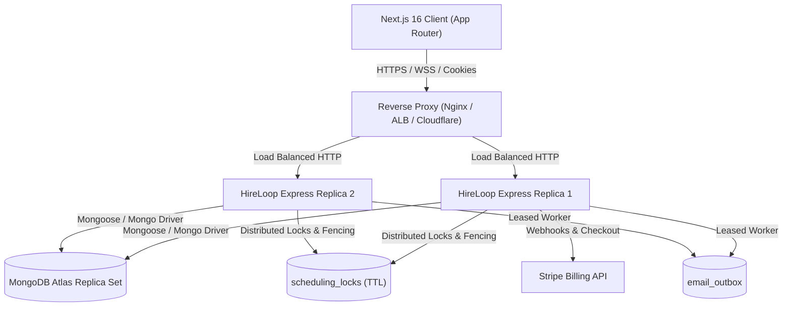

# HireLoop — Staging Deployment & Production Operations Runbook

## 1. System Architecture & Intended Staging Topology

HireLoop operates a decoupled full-stack architecture designed for enterprise recruitment workflows, zero-trust tenant isolation, and restart-resilient background processing.

- **Frontend (`hireloop-client`)**: Next.js 16 (App Router with Turbopack), React 19, Tailwind CSS. Consumes backend endpoints using HTTP-only cookies (`better-auth.session_token` / `__Secure-better-auth.session_token`) and Bearer token fallback.
- **Backend (`hireloop-server`)**: Node.js & Express API with MongoDB persistence, distributed atomic locks with lease renewal, unified background scheduler, and transactional email outbox.
- **Data Tier**: MongoDB (Atlas Replica Set recommended). Provides atomic multi-document operations and TTL eviction.
- **Billing Integration**: Stripe Checkout and webhook lifecycle integration.
- **Real-Time Communication**: Server-Sent Events (SSE) stream for instant notifications and candidate messaging.

### Intended Staging Topology
- **API Server Replicas**: The Express backend is stateless with respect to HTTP requests and can scale across 1 to N replicas behind a reverse proxy (e.g. AWS ALB, Nginx, Cloudflare, Fly.io).
- **Background Scheduler & Outbox Worker**:
  - The scheduler runs within the Express process (`startScheduler()`), executing every 30 seconds.
  - Background outbox workers utilize **unique attempt-specific atomic document leasing** (`status: "processing"`, `lockedBy: WORKER_ID_att_<ts>_<rand>`, `lockedAt: new Date()`) with automatic 5-minute lease timeout recovery. Multiple replicas can safely execute concurrently without duplicate email delivery.
- **Reverse Proxy**: Express is configured with `app.set("trust proxy", 1)` to correctly parse `req.ip` from `X-Forwarded-For` for sliding-window rate limiting (`rateLimiter.js`).



---

## 2. Complete Environment Variable Inventory

Every environment variable that actually exists across `hireloop-client` and `hireloop-server` is cataloged below:

| Variable | Required | Service | Purpose | Staging Configuration Status |
| :--- | :--- | :--- | :--- | :--- |
| `NEXT_PUBLIC_API_URL` | Yes | Frontend | Root URL of Express backend API for browser & SSR | Configured (`http://localhost:5001` or staging domain) |
| `BETTER_AUTH_SECRET` | Yes | Frontend | 32+ char high-entropy key for session token signing | Configured |
| `BETTER_AUTH_URL` | Yes | Frontend | Canonical origin for client authentication callbacks | Configured (`http://localhost:3000` or staging domain) |
| `NEXT_PUBLIC_BETTER_AUTH_URL`| No | Frontend | Client-side fallback for Better Auth origin | Optional |
| `MONGODB_URI` | Yes | Both | MongoDB connection string (Replica Set recommended) | Configured |
| `AUTH_DB_NAME` | No | Frontend | Database name for Better Auth collections (default: `hireloop`) | Configured (`hireloop_db`) |
| `PORT` | No | Backend | TCP port Express server listens on (default: `5001`) | Configured (`5001`) |
| `NODE_ENV` | No | Backend | Runtime mode (`development`, `staging`, `production`) | Configured (`staging` / `development`) |
| `CLIENT_ORIGIN` | Yes | Backend | Allowed CORS origin for credentials and cookies | Configured (`http://localhost:3000` or staging domain) |
| `DB_NAME` | No | Backend | Core recruitment database name (default: `hireloop`) | Configured (`hireloop_db`) |
| `INITIAL_SUPER_ADMIN_EMAIL`| Required in prod | Backend | Explicit bootstrap email for initial `super_admin` | Configured in `.env.example` |
| `STRIPE_SECRET_KEY` | Yes (Billing) | Backend | Stripe API Secret Key (use test mode `sk_test_...`) | Configured (`sk_test_...`) |
| `STRIPE_WEBHOOK_SECRET` | Yes (Billing) | Backend | Stripe Webhook Signing Secret (`whsec_...`) | Required via Stripe CLI / Dashboard |
| `STRIPE_PRICE_SEEKER_PRO` | Yes (Billing) | Backend | Stripe Price ID for Seeker Pro plan | Configured (test placeholder) |
| `STRIPE_PRICE_SEEKER_PREMIUM` | Yes (Billing) | Backend | Stripe Price ID for Seeker Premium plan | Configured (test placeholder) |
| `STRIPE_PRICE_RECRUITER_GROWTH`| Yes (Billing) | Backend | Stripe Price ID for Recruiter Growth plan | Configured (test placeholder) |
| `STRIPE_PRICE_RECRUITER_ENTERPRISE`| Yes (Billing)| Backend| Stripe Price ID for Recruiter Enterprise plan | Configured (test placeholder) |
| `EMAIL_FROM` | No | Backend | Default sender address for transactional emails | Configured (`notifications@hireloop.dev`) |
| `RESEND_API_KEY` | Optional | Backend | Resend API key for live transactional email delivery | Optional (simulated when omitted) |
| `SMTP_HOST` | Optional | Backend | Fallback SMTP relay host | Optional |
| `SMTP_PORT` | Optional | Backend | Fallback SMTP port (default: `587`) | Optional |
| `SMTP_USER` | Optional | Backend | Fallback SMTP username | Optional |
| `SMTP_PASS` | Optional | Backend | Fallback SMTP password | Optional |
| `SMTP_SECURE` | Optional | Backend | TLS toggle for SMTP (`true` for port 465) | Optional |
| `VAPID_PUBLIC_KEY` | Optional | Backend | Web Push VAPID public key | Optional (graceful fallback when absent) |
| `VAPID_PRIVATE_KEY` | Optional | Backend | Web Push VAPID private key | Optional (graceful fallback when absent) |
| `VAPID_SUBJECT` | Optional | Backend | Web Push mailto/URL subject contact | Optional |

---

## 3. Database Indexes, Initialization & Safe Migration Strategy

### Automated Startup Indexes (`hireloop-server/src/db.js`)
Indexes are automatically created on database connection during server startup:

1. **Concurrency & Scheduling Locks (`scheduling_locks`)**:
   - `{ lockKey: 1 }` (Unique): Enforces mutual exclusion across concurrent booking attempts.
   - `{ expiresAt: 1 }` (TTL: `expireAfterSeconds: 0`): Guarantees automatic eviction of dead locks.
2. **Company Workspaces & Vacancies**:
   - `company_memberships`: `{ companyId: 1, userEmail: 1 }` (Unique), `{ userEmail: 1, status: 1 }`
   - `company_invitations`: `{ tokenHash: 1 }` (Unique), `{ expiresAt: 1 }` (TTL)
   - `jobs`: `{ companyId: 1, status: 1 }`, `{ assignedMemberEmails: 1 }`
3. **Conversations & Messages**:
   - `conversations`: `{ applicationId: 1 }` (Unique)
   - `messages`: `{ idempotencyKey: 1 }` (Unique, Sparse), `{ conversationId: 1, createdAt: 1 }`
4. **Outbox & Notifications**:
   - `email_outbox`: `{ status: 1, nextAttemptAt: 1 }`, `{ idempotencyKey: 1 }` (Unique, Sparse)
   - `scheduled_reminders`: `{ status: 1, dueAt: 1 }`, `{ interviewId: 1, status: 1 }`
5. **Security, Auditing & Moderation**:
   - `user`: `{ email: 1 }`, `{ role: 1, adminRole: 1 }`
   - `audit_logs`: `{ timestamp: -1 }`, `{ companyId: 1, timestamp: -1 }`
   - `reports`: `{ targetType: 1, targetId: 1 }`, `{ reporterEmail: 1, targetId: 1 }`

### Safe Startup Migrations & Bootstrap Rules
- **`migrateLegacyAdmins()`**:
  - Idempotent and safe to rerun on every deployment.
  - If `NODE_ENV === "production"`, startup **strictly requires** `INITIAL_SUPER_ADMIN_EMAIL` when no active super admin exists, failing safely if omitted.
  - Only the explicitly configured email receives `super_admin`.
  - All other unassigned legacy admin accounts strictly receive `support_moderator` (least-privilege default).
  - Every migration is audited in `audit_logs`.
- **`migrateCompanyMemberships()`**:
  - Idempotent backfill ensuring every verified company owner has an active `company_owner` membership record in `company_memberships`.
- **Demo Seeding Guard**:
  - In `production` mode (`NODE_ENV === "production"`), mock demo companies and placeholder jobs are **strictly suppressed**, ensuring clean customer databases.

---

## 4. Distributed Concurrency & Fencing Boundary Strategy

### Interview Booking Mutual Exclusion (`bookingLockService.js`)
1. **Deterministic Order**: Lock keys are normalized (`participant:<email>`), deduplicated, and sorted lexicographically before acquisition, eliminating deadlock risks across multi-party panels.
2. **Heartbeat Lease Renewal**: A background timer runs every `timeoutMs / 3` (~3 seconds for a 10s lease) extending `expiresAt` while the operation is in flight.
3. **Fencing Token Assertion (`assertLockValid`)**: If an execution stalls or a lock is lost, `assertLockValid()` throws a 409 Conflict with code `LOCK_LEASE_LOST`.
4. **Persistence Compensation Rollbacks**: If a delayed worker wakes up after lease loss and attempts an insert or update, `checkLockValidity()` aborts the transaction and immediately triggers registered compensation rollbacks (e.g. deleting the stale interview document or restoring previous state).
5. **Scoped Release**: `releaseBookingLocks` strictly scopes deletion to `{ lockToken, lockKey: { $in: lockKeys } }`, ensuring a worker never deletes another worker's acquired lock.

---

## 5. Email Outbox — Real Delivery & Failure Recovery

### A. Attempt-Specific Atomic Leasing (`outboxWorker.js` & `emailService.js`)
- Every claim generates a unique attempt identifier: `${WORKER_ID}_att_${Date.now()}_${Math.random().toString(36).substring(2, 7)}`.
- Concurrent delivery from direct async calls and background workers cannot collide.

### B. Provider Idempotency & Ambiguous Outcomes
- **Resend API**: Passes native `Idempotency-Key` header derived from `outboxItem.idempotencyKey || outboxItem._id.toString()`. If a worker crashes after Resend accepted the email but before writing to MongoDB, the recovering worker passes the same key, preventing duplicate customer emails.
- **SMTP Relay**: Passes RFC 5322 `Message-ID: <<idempotencyKey>@hireloop.dev>`. Because SMTP wire protocol (RFC 5321) lacks native idempotency, duplicate delivery is an inherent at-least-once risk if a crash occurs between SMTP `250 OK` and the database write.
- **Preference Re-Check**: Validates `shouldDeliverEmail` right before provider transmission. If a user disabled notifications while queued, the message is marked `suppressed`.

---

## 6. Health Probes, Monitoring & Diagnostics

HireLoop exposes two distinct operational endpoints for monitoring and orchestrators:

### 1. Fast Liveness Probe (`GET /health`)
- **Purpose**: Verifies that the Express process is running and accepting HTTP traffic.
- **Response** (HTTP 200):
  ```json
  {
    "status": "ok",
    "database": "connected",
    "environment": "staging",
    "uptimeSeconds": 1420
  }
  ```

### 2. Deep Readiness Probe (`GET /ready` or `GET /health/ready`)
- **Purpose**: Verifies active MongoDB ping latency, background scheduler state, and outbox worker status before routing live traffic.
- **Response** (HTTP 200 when ready, HTTP 503 when degraded):
  ```json
  {
    "status": "ready",
    "database": {
      "status": "connected",
      "latencyMs": 3
    },
    "scheduler": {
      "active": true,
      "lastCycleAt": "2026-11-01T21:00:00.000Z"
    },
    "outboxWorker": {
      "active": true
    },
    "environment": "staging",
    "uptimeSeconds": 1420
  }
  ```

### 3. Graceful Shutdown
On `SIGTERM` or `SIGINT`:
1. `stopScheduler()` and `stopOutboxWorker()` stop background timer loops.
2. `server.close()` stops accepting new HTTP connections and waits for active requests to finish.
3. A 10-second fail-safe timeout prevents hung processes from stalling rolling deployments.
4. `closeDatabase()` cleans up MongoDB connection pools before process exit.

---

## 7. Build, Verification & Deployment Commands

### Backend API (`hireloop-server`)
```bash
# 1. Install dependencies
npm ci

# 2. Run automated test suite (154 tests)
npm test

# 3. Start server
npm start
```

### Frontend Client (`hireloop-client`)
```bash
# 1. Install dependencies
npm ci

# 2. Type validation
npx tsc --noEmit

# 3. ESLint check
npm run lint

# 4. Production build (Turbopack)
npm run build

# 5. Start Next.js server
npm start
```

---

## 8. Rollback & Disaster Recovery Procedures

1. **Traffic Rollback**:
   - If `/ready` reports HTTP 503 or error rate spikes, revert container image tag to previous stable release in load balancer / orchestrator.
   - Zero-downtime rolling deployments ensure old replicas remain active until new ones pass `/ready`.
2. **Database Rollback**:
   - Schema modifications in HireLoop are non-destructive and backward compatible. Rolling back the application code does not require rolling back database indexes.
3. **Stale Lock Recovery**:
   - If an unexpected cluster failure occurs, locks automatically expire via MongoDB TTL within 10 seconds.
   - Manual emergency unlock:
     ```javascript
     db.scheduling_locks.deleteMany({ expiresAt: { $lt: new Date() } });
     ```
4. **Stuck Outbox Items**:
   - Abandoned outbox messages are automatically reclaimed after 5 minutes by the outbox worker.
   - Manual recovery query:
     ```javascript
     db.email_outbox.updateMany(
       { status: "processing", lockedAt: { $lt: new Date(Date.now() - 300000) } },
       { $set: { status: "pending", lockedBy: null, lockedAt: null } }
     );
     ```
